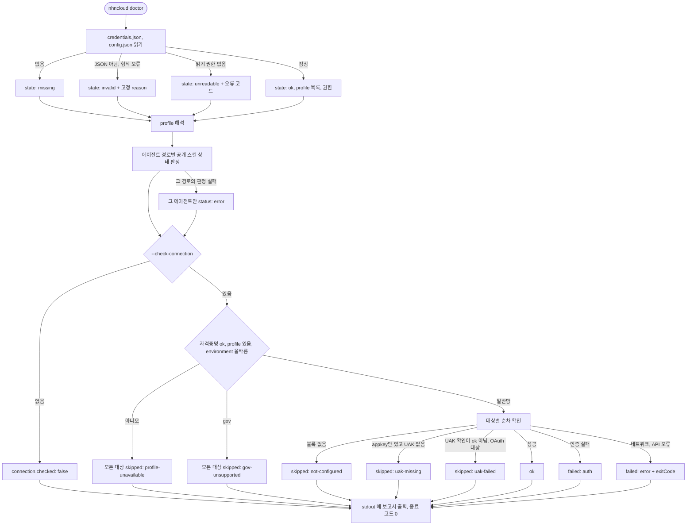
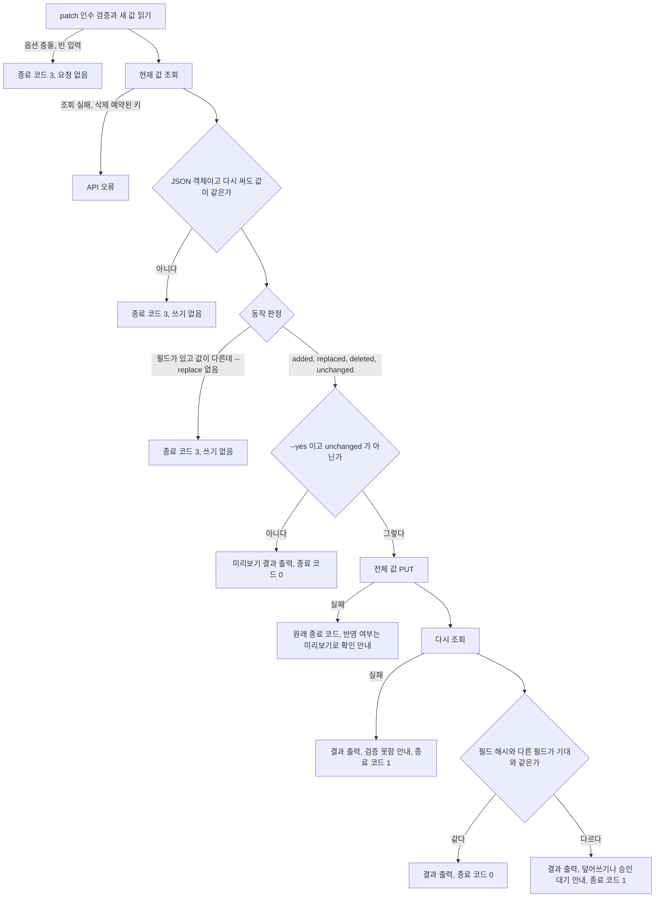
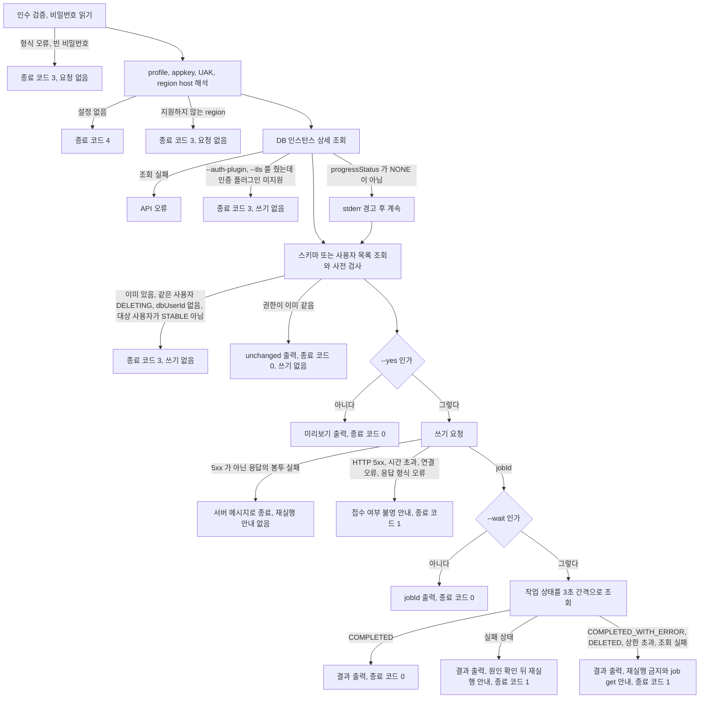
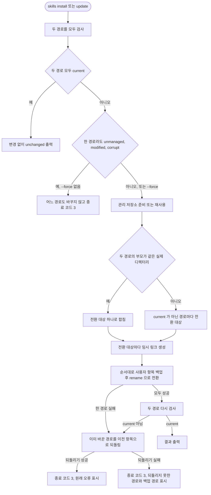

# User Flow: nhncloud-cli

이 문서는 명령을 나열하지 않고 사용자가 거치는 흐름과 실패 경계를 설명한다.
전체 명령, 인수와 옵션은 `nhncloud --help`와 `nhncloud commands --json`에서 확인한다.

## 공통 실행 흐름

1. 사용자가 명령과 `--profile`을 선택한다.
2. CLI가 인수·옵션을 검증하고 위험한 쓰기라면 확인 조건을 검사한다.
3. profile 우선순위에 따라 자격증명을 읽는다.
4. OAuth, Keystone 또는 서비스 고유 인증으로 client를 만든다.
5. API를 호출하고 서비스 응답을 공통 오류로 정규화한다.
6. 데이터는 stdout, 진행 상황·경고·오류는 stderr로 출력한다.

`--json`은 구조화된 전체 결과를, `--quiet`은 다음 명령에 넘길 핵심 값만 출력한다.
자격증명이나 인수가 잘못되면 외부 요청과 spinner를 시작하기 전에 종료한다.

프록시를 거쳐야 하는 환경은 전역 옵션 `--proxy <url>`이나 `HTTPS_PROXY`·`HTTP_PROXY`를 준다([[adr-044]]).
CLI는 명령 실행 전에 값을 검증하고, 토큰 발급과 연결 확인을 포함한 모든 HTTP 요청에 같은 프록시를 쓴다.

- `--proxy`가 환경변수보다 우선하고, `NO_PROXY`에 맞는 host는 `--proxy`를 줘도 직접 연결한다.
- 값이 `http:`나 `https:` URL이 아니면 자격증명을 읽기 전에 종료 코드 3으로 끝난다. 오류에는 값 대신 옵션이나 환경변수 이름만 나온다.
- 프록시 연결이 실패하면 API 오류(종료 코드 1)로 끝나고, 오류 문구에 연결 실패 원인을 덧붙인다.

## 공통 CLI 입력 오류

필수 옵션 누락은 Commander의 `requiredOption`과 명령 내부의 수동 검증 모두 종료 코드 3으로 끝난다(ADR-035).
Commander가 먼저 발견한 누락은 기존 영문 오류를 stderr에 한 번만 출력하고, 수동 검증은 기존 오류 문구를 유지한다.
두 경우 모두 API를 호출하거나 stdout에 데이터를 출력하지 않는다.

알 수 없는 옵션이나 불필요한 인수 같은 다른 Commander 문법 오류는 종료 코드 1을 유지한다.
도움말과 버전 출력은 종료 코드 0이다.
`--json`과 `--quiet`은 파서 오류를 데이터 출력으로 바꾸지 않는다.

알 수 없는 옵션의 이름이 그 명령의 위치 인수를 가리키면, Commander 오류 줄 뒤에 안내 두 줄을 stderr에 덧붙인다.
첫 줄은 그 값을 어느 위치 인수로 넘기는지, 둘째 줄은 Commander가 만든 그 명령의 사용법이다.
명령마다 문구를 두지 않고 Commander에 등록된 인수 이름과 명령 경로로 만든다.

```text
$ nhncloud instance get --instance-id <instance-id>
error: unknown option '--instance-id'
안내: --instance-id 는 옵션이 아닙니다. 위치 인수 <id> 로 전달하세요.
사용법: nhncloud instance get [options] <id>
```

옵션 이름이 위치 인수를 가리킨다고 보는 경우는 셋이다.
비교 전에 `--`와 `=값`을 떼고, camelCase로 선언한 인수 이름(`volumeId`)은 kebab-case(`volume-id`)로 바꾼다.

| 판정 | 예 |
|---|---|
| 인수 이름과 같다 | `instance volume detach`의 `--volume-id`와 `<volumeId>` |
| 인수 이름이 `<옵션 이름>-`으로 시작하고 그런 인수가 하나뿐이다 | `instance security-group add`의 `--instance`와 `<instance-id>` |
| 옵션 이름이 `<명령 경로의 한 단계 이름>-<인수 이름>`이다 | `instance get`의 `--instance-id`와 `<id>` |

첫 판정에 맞는 인수가 있으면 그것을 안내한다.
없으면 둘째와 셋째 판정에 맞는 인수를 모으고, 정확히 하나일 때만 안내한다.
셋째 판정은 그 명령의 다른 인수 이름과 같은 단계를 쓰지 않는다. `ncs template version get <id> <version>` 의 `--version-id` 가 템플릿 ID 를 가리키지 않게 하기 위해서다.
어느 판정에도 맞지 않거나 후보가 둘 이상이면 Commander 오류 줄만 남긴다.
짧은 옵션(`-x`)과 옵션 이름 오타는 다루지 않는다.
오타는 Commander가 `(Did you mean ...)`으로 이미 제안한다.
Commander가 비슷한 옵션을 제안했으면 판정이 맞아도 안내를 붙이지 않는다.
`instance volume attach <id> --volume <volumeId>`에 `--volume-id`를 더하면 셋째 판정이 `<id>`를 가리키지만, 실제 의도는 제안된 `--volume`이다.
필수 옵션이 빠진 호출은 Commander가 필수 옵션 누락을 먼저 보고하므로 안내가 붙지 않는다.

안내는 종료 코드와 stdout을 바꾸지 않는다.
`--json`이나 `--quiet`을 함께 줘도 안내는 stderr에 나간다.
알 수 없는 옵션을 위치 인수로 해석해 명령을 실행하지도 않는다.
틀린 호출이 성공하면 호출자가 무엇이 틀렸는지 알 수 없고, 이름이 겹치지 않는 값이 엉뚱한 인수로 들어갈 수 있기 때문이다.

## 최초 설정

`nhncloud configure`는 대화형 입력과 CI용 flag 입력을 모두 지원한다.

- profile을 정하고 공통 UAK와 필요한 서비스 블록만 저장한다.
- 비대화형 flag가 하나라도 있으면 prompt를 열지 않는다.
- 기본 동작은 이번에 입력한 자격증명을 확인한다. `--no-verify`를 주면 연결 테스트를 생략한다.
- 연결 테스트는 저장할 profile의 `environment`가 가리키는 망 주소로만 보낸다. 아직 파일에 없는 새 profile은 일반망으로 검증하므로, 새 공공망 profile은 `--no-verify`로 저장하고 `environment`를 추가한다.
- 자격증명은 `credentials.json`, 기본 profile 같은 일반 설정은 `config.json`에 둔다.

설정 후 `nhncloud doctor`로 파일 상태와 권한, profile과 공개 스킬 상태를 진단할 수 있다.
자격증명과 설정 파일의 필드는 [data-schema.md](data-schema.md)를 따른다.

## 설정 진단

`doctor`는 기본으로 외부 API를 호출하지 않는다.
`--check-connection`을 줄 때만 대상 profile 하나의 연결을 확인한다([[adr-042]]).
텍스트, `--json`, `--quiet`는 같은 진단 결과를 다른 모양으로 낸다.
`--json` 필드와 상태 값은 [공개 스킬 common reference](../skills/nhncloud-cli/references/common.md#설정-진단)의 「설정 진단」 절이 소유한다.



- 진단 대상 파일이 없거나 손상돼도 보고서는 나온다. 자격증명이 없는 빈 HOME 에서도 `doctor --json`은 온전한 JSON 을 낸다.
- 연결 확인은 `configure`의 연결 테스트 함수를 그대로 쓰고 토큰 캐시를 읽거나 쓰지 않는다.
- 연결 확인 대상은 `userAccessKey`, `iaas`, `logncrash`, `ncr`, `ncs` 순서로 하나씩 확인한다. 한 대상의 실패는 다음 대상 확인을 막지 않는다. 다만 `userAccessKey` 확인이 `ok`가 아니면 같은 UAK 로 OAuth 토큰을 받는 `logncrash`, `ncs`는 `uak-failed`로 건너뛰어 같은 실패를 반복 대기하지 않는다.
- 해석한 profile 에 자격증명 블록이 하나도 없으면 `ready`는 `false`다.
- 보고서를 냈으면 종료 코드는 0이다. 알 수 없는 옵션 같은 입력 오류만 기존 종료 코드 규칙을 따른다.
- 진단 결과는 stdout 에 쓴다. 자격증명의 비밀값과 appkey 는 어떤 출력에도 넣지 않는다.

## 명령 탐색

사람은 단계별 help로 범위를 줄여 가며 찾는다.

```bash
nhncloud --help
nhncloud instance --help
nhncloud instance create --help
```

에이전트와 스크립트는 `nhncloud commands --json`에서 경로, 인수와 옵션 메타데이터를 읽는다.
이 명령은 외부 API와 자격증명을 사용하지 않는다.

## 서비스별 시작점

| 영역 | 일반 흐름 | 상세 사용자 가이드 |
|---|---|---|
| Log & Crash | 조회 토큰 확인, 검색, 대량 export, 로그 전송 | [logncrash.md](../skills/nhncloud-cli/references/logncrash.md) |
| Deploy | 좌표 탐색, 배포 실행, 바이너리 전송 | [deploy.md](../skills/nhncloud-cli/references/deploy.md) |
| Instance·Network·Volume·Floating IP | 리소스 탐색 뒤 조회·생성·변경 | [iaas.md](../skills/nhncloud-cli/references/iaas.md) |
| Load Balancer | 대상 탐색, IP ACL 변경과 부분 실패 복구 | [loadbalancer.md](../skills/nhncloud-cli/references/loadbalancer.md) |
| NCR | registry 조회 뒤 image와 tag 탐색 | [ncr.md](../skills/nhncloud-cli/references/ncr.md) |
| NKS | 지원 버전과 리소스를 조회한 뒤 변경 | [nks.md](../skills/nhncloud-cli/references/nks.md) |
| NCS | template을 기준으로 workload를 만들고 관찰 | [ncs.md](../skills/nhncloud-cli/references/ncs.md) |
| API Gateway | service·stage·resource 탐색 뒤 설정·배포 | [apigateway.md](../skills/nhncloud-cli/references/apigateway.md) |
| Secure Key Manager | 키 저장소와 키 탐색 뒤 기밀 데이터 조회, 암복호화, 서명과 검증 | [skm.md](../skills/nhncloud-cli/references/skm.md) |
| RDS for MySQL | DB 인스턴스 탐색 뒤 DB 스키마와 DB 사용자 조회·변경 | [rds-mysql.md](../skills/nhncloud-cli/references/rds-mysql.md) |

## 조회와 페이지 이동

조회 명령은 가능한 한 table을 기본으로 하고 JSON과 quiet 출력을 함께 제공한다.
목록 API의 cursor나 paging은 응답에 존재할 때만 다음 요청에 사용한다.
빈 결과는 성공이며 데이터 출력으로 표현한다.

Log & Crash 검색은 상대시간과 절대시간을 UTC 범위로 정규화한다.
검색과 export는 각 검색 요청 직전에 조회 토큰 잔량을 확인한다.
잔량이 0 이하면 검색 요청을 보내지 않고 API 오류로 끝내며, 관측한 회복 속도로 양수가 될 때까지의 추정 대기 시간을 안내한다.
잔량 조회가 실패해도 검색 요청을 보내지 않고 원래 오류를 전달한다.
양수 잔량은 다음 요청의 비용까지 충분하다는 보장이 아니며, 동시 소비로 실제 요청이 429를 반환할 수 있다.
CLI는 자동으로 기다리거나 다시 시도하지 않고, export가 중간에 멈추면 받은 결과를 보존한다(ADR-032, ADR-036).
대량 export는 API 제한에 맞게 기간과 페이지를 나누며, 실패한 다음 요청을 성공으로 숨기지 않는다.
조회 중 실패한 결과는 `.partial`, 조회를 마쳤지만 JSON 배열을 닫지 못한 결과는 `.unfinalized`, 형식까지 완성했지만 최종 경로로 교체하지 못한 결과는 `.complete`로 보존한다.
복구 파일은 실행별 고유 경로를 쓰며 뒤의 성공 실행이 자동으로 삭제하지 않는다(ADR-032, ADR-034).
NCS logs와 events도 같은 시간 해석 유틸리티를 재사용한다.

## 쓰기 명령의 공통 흐름

1. 리소스 ID와 입력 파일을 로컬에서 검증한다.
2. 위험한 변경은 API 호출 전에 `--yes` 또는 명시적 확인을 요구한다.
3. API가 비동기 작업을 반환하면 기본 동작과 `--wait`의 차이를 help에 드러낸다.
4. 여러 하위 작업 중 일부만 실패하면 성공·실패 대상을 구조화해 반환한다.
5. 재실행 시 중복 생성이나 상태 역전을 일으킬 수 있는지 오류에 설명한다.

복잡한 NKS·NCS·API Gateway payload는 JSON 파일을 사용한다.
파일 크기, JSON 형태와 경로 안전성을 확인한 뒤 요청한다.

## IaaS 흐름

IaaS 서비스는 profile의 Keystone 자격증명과 region을 해석하고 토큰과 endpoint를 공유한다.
탐색은 목록에서 이름과 UUID를 확인한 뒤 상세 조회나 쓰기로 진행한다.

- Instance 생성은 비동기가 기본이며 `--wait`를 주면 ACTIVE와 주소 확인까지 기다린다.
- delete, 전원 제어와 resize는 대상 확인을 먼저 수행한다.
- Network, Floating IP, Volume과 Load Balancer는 같은 Keystone 토큰을 재사용하되 서로 다른 endpoint 경계를 쓴다.
- Load Balancer IP ACL 대상 변경은 기존 binding을 보존해 재바인딩하고, 부분 실패를 숨기지 않는다.
- 보안그룹은 이름이나 UUID로 지정한다. UUID가 일치하면 그 그룹을 쓰고, 이름이 없거나 중복되면 후보 UUID와 함께 입력 오류로 끝난다.
- 보안그룹 연결 포트 조회는 연결 API 결과에 Compute 인스턴스 목록의 이름을 붙인다.
  `device_owner`가 `compute:`로 시작하는 포트만 대상이다.
  인스턴스 목록 조회가 실패하면 이름 칸을 비우고 stderr에 경고를 남기며, 연결 정보는 그대로 출력하고 성공으로 끝난다.
  `--quiet`은 다음 명령에 넘길 인스턴스 UUID를 중복 없이 출력한다.
- 보안그룹 삭제, 규칙 삭제와 인스턴스 연결 변경은 `--yes`가 없으면 API 요청 전에 종료 코드 3으로 끝난다(ADR-038).
  그룹 삭제는 연결된 포트가 있으면 거부하고, 다른 그룹 규칙의 원격 그룹 참조는 stderr 경고로 남긴 뒤 진행한다.
- 인스턴스 연결 변경은 같은 이름의 그룹이 둘 이상이면 요청 전에 거부한다. 이미 연결된 그룹 추가는 요청 없이 성공하고, 연결되지 않은 그룹 해제는 입력 오류다.
  요청 뒤 연결 조회로 결과를 확인하고, 반영되지 않았으면 stderr에 경고를 남긴다.
- 규칙 생성은 방향, 프로토콜과 포트 조합, IPv4 CIDR, CIDR과 원격 그룹의 동시 지정을 요청 전에 검증한다.
  규칙 수정 API가 없어 교체는 새 규칙 생성과 옛 규칙 삭제를 차례로 실행하며 원자적이지 않다.

## 서비스 고유 흐름

### Deploy와 OAuth 서비스

공통 UAK를 OAuth access token으로 교환하고 profile의 서비스 appkey를 경로에 사용한다.
배포 좌표는 명령 옵션으로 받으며 profile에 저장하지 않는다.
같은 계정 토큰 캐시를 공유하는 서비스 목록은 [data-schema.md](data-schema.md)의 「토큰 캐시」 절을 따른다.
서비스별 헤더와 응답 봉투는 client가 책임진다.

### NCR

Management API는 공통 UAK 정적 헤더와 profile의 NCR appkey를 쓴다.
image와 tag 조회는 registry 응답의 host를 검증한 뒤 Harbor REST에 UAK Basic Auth로 접근한다.
관리 API와 data plane 응답을 같은 봉투로 가정하지 않는다.

### API Gateway 배포

설정 변경 뒤 resource를 stage에 반영하고 새 배포를 만든다.
배포 생성 응답만으로 완료를 단정하지 않고 배포 상태를 조회한다.
rollback도 새 상태 전이를 만들 수 있으므로 완료와 실패를 같은 방식으로 확인한다.

### Secure Key Manager

공통 UAK를 OAuth access token으로 교환하고 profile의 `skm.appkey`를 경로에 쓴다. 망은 profile `environment`로 고른다.
`skm keystore list`와 `skm key list`로 키 저장소 ID와 키 ID를 찾은 뒤, 저장된 키를 쓰는 명령(기밀 데이터 조회, 암복호화, 서명과 검증, 키 원문 조회)에 키 ID를 넘긴다.
키 목록은 응답에 전체 개수가 없어, 받은 개수가 요청한 페이지 크기보다 적을 때까지 다음 페이지를 요청해 모은다.

저장된 키를 쓰는 명령은 키 저장소의 클라이언트 인증을 통과해야 한다.

- IPv4 인증은 서버가 본 요청 출발지 IP로 판정하므로 CLI가 따로 보내는 값이 없다.
- MAC 인증은 `--mac-address`로 준 콜론 구분 값을 소문자로 바꿔 헤더로 보낸다. 형식이 틀리면 자격증명을 읽기 전에 종료 코드 3으로 끝난다.
- 인증서 인증만 켠 키 저장소는 지원하지 않는다. 인증 실패는 서버의 `resultMessage`를 담은 API 오류로 끝난다.
- `skm confirm`은 서버가 본 클라이언트 IP, MAC 헤더와 인증서 사용 여부를 보여 준다. 인증 실패 원인을 찾을 때 먼저 실행한다.

암호화·서명할 데이터는 `--plaintext`, `--file`, 표준 입력 순으로 읽고 받은 바이트를 그대로 보낸다. 끝 줄바꿈과 앞의 UTF-8 BOM도 지우지 않는다.
암호문과 서명값은 base64 문자열이라 앞뒤 공백을 지운다.
입력 크기 한도(암호화 32KB, 일반 서명 245바이트, 표준 스킴 서명 64KB)는 자격증명을 읽기 전에 검사한다.

비밀값을 받으려고 부른 명령(기밀 데이터 조회, 복호화, 키 원문 조회, local key 생성)은 값을 숨기지 않는다. `--quiet`은 원문 뒤에 줄바꿈 하나를 붙이고, `--json`은 응답 그대로, 사람이 읽는 기본 출력은 제어 문자만 `?`로 바꾼 값을 출력한다.
인증서 인증 정보 조회는 모든 출력 형식에서 `password`를 `***`로 가린다([[adr-039]]).
서명 검증 결과가 `false`면 결과를 stdout에 출력하고 stderr에 실패를 알린 뒤 종료 코드 1로 끝난다.

#### Secure Key Manager 쓰기

키 저장소를 만들고(`skm keystore create`), 인증 정보를 등록하고(`skm keystore auth add`), 키를 만드는(`skm key create`) 순서로 쓴다([[adr-040]]).

- 키 생성과 인증 정보 명령은 `<keystore-id>`를 받는다. CLI가 키 저장소 상세 조회로 이름을 얻어 요청에 넣는다. 조회가 실패하면 쓰기 요청을 보내지 않는다.
- 기밀 데이터 값과 인증서 비밀번호는 `--value`·`--password`, 파일, 표준 입력 순으로 읽는다. 셸 기록에 남지 않게 파일이나 표준 입력을 권장한다. 기밀 데이터 값은 받은 그대로 보내고, 인증서 비밀번호만 끝의 줄바꿈 하나(`\n` 또는 `\r\n`)를 지운다. 기밀 데이터 수정 응답의 값은 출력하지 않는다.
- 키 저장소 수정은 현재 값을 읽어 주지 않은 항목을 채운 뒤 전체를 보낸다. 조회 응답에 `authMode`가 없어 `--auth-mode`는 필수다. `--description`에 빈 값을 주면 현재 설명을 유지하므로 설명을 지우는 경로는 없다. 인증 사용 여부가 모두 꺼지는 요청은 API 호출 전에 거부한다.
- 대칭키·비대칭키 생성은 자동 회전 주기 0을 보낸다.
- 삭제는 두 단계다. `delete`는 7일 뒤 삭제를 예약하고, `purge`는 예약된 대상만 즉시 지운다. 키 저장소 `delete`는 비활성화다.
  모든 삭제 명령은 `--yes`가 없으면 자격증명을 읽기 전에 종료 코드 3으로 끝난다.
- 인증 정보를 지우거나 키 저장소의 인증 설정을 바꾸면 이 CLI를 실행한 위치가 키를 쓰지 못하게 될 수 있다. 바꾸기 전에 `skm confirm`으로 현재 클라이언트 IP·MAC을 확인한다.
- 쓰기 요청이 실패하면 서버의 `resultMessage`를 담은 오류로 끝나고 재시도하지 않는다. 생성 명령을 다시 실행하면 같은 이름의 리소스를 다시 만들려고 하며 결과는 서버 규칙을 따른다.

#### 기밀 데이터 필드 수정

값이 JSON 객체인 기밀 데이터는 필드 하나를 `skm secret get <key-id> --field <name>`으로 읽고 `skm secret patch <key-id> <field>`로 바꾼다([[adr-045]]).
`get --field`는 문자열 필드면 원문을, 다른 타입이면 JSON 표기를 출력한다. 필드가 없거나 값이 JSON 객체가 아니면 종료 코드 3으로 끝난다.



- 새 값은 `--file`이나 표준 입력으로만 받는다. `--delete`는 새 값을 받지 않으며 `--file`·`--replace`와 함께 쓸 수 없다.
- 기본은 미리보기라 `--yes`가 없으면 쓰지 않는다. 동작이 `unchanged`면 `--yes`를 줘도 요청하지 않는다. 지울 필드가 없으면 `unchanged`다.
- 출력에는 값과 해시가 없다. `--json`은 `keyId`, `field`, `action`, `applied`, `fieldVerified`, `othersVerified`를, `--quiet`은 `action`만 낸다. 반영하지 않았거나 다시 조회하지 못했으면 두 대조 값은 `null`이다.
- 쓰기 요청이 실패하면 반영 여부를 알 수 없는 경우가 있다. 같은 명령을 `--yes` 없이 다시 실행해 `unchanged`인지 확인한다. 같은 값이면 다시 실행해도 쓰지 않는다.
- 같은 키를 동시에 고치면 나중에 쓴 쪽이 앞의 변경을 덮어쓴다. 다시 조회한 값이 기대와 다르면 종료 코드 1로 알리지만 덮어쓴 값은 되돌리지 못한다.

### RDS for MySQL

profile 공통 UAK를 정적 헤더로, `rds-mysql.appkey`를 `X-TC-APP-KEY` 헤더로 보낸다. 망은 profile `environment`로, region은 `--region`(기본 `kr1`)으로 고른다([[adr-046]]).
일반망은 `kr1`, `kr2`, `jp1`, 공공망은 `kr1`만 받는다. 다른 region은 자격증명을 읽은 뒤, API 호출 전에 종료 코드 3으로 끝난다.
`rds-mysql instance list`로 DB 인스턴스 ID를 찾고, `schema list`와 `user list`에 넘긴다. `user list`의 `dbUserId`를 `user update`와 `user delete`에 넘긴다.
ID 인수(`<db-instance-id>`, `<db-user-id>`, `<job-id>`)는 UUID만 받고 이름은 해석하지 않는다. 같은 이름의 사용자가 host마다 있을 수 있기 때문이다. 형식이 틀리면 자격증명을 읽기 전에 종료 코드 3으로 끝난다.
목록 API에는 페이지가 없어 한 번의 응답을 그대로 출력한다. 빈 목록도 성공이다.

#### RDS for MySQL 쓰기

`schema create`, `user create`, `user update`, `user delete`는 같은 흐름을 따른다([[adr-047]]).



- 스키마 이름, 사용자 이름, host의 형식은 자격증명을 읽기 전에 검사하고 틀리면 종료 코드 3이다. 규칙은 공식 문서의 제약을 따르며 사용자 안내는 [rds-mysql.md](../skills/nhncloud-cli/references/rds-mysql.md)가 소유한다. MySQL 예약어인지는 서버가 판정한다.
- 미리보기와 반영은 같은 사전 검사를 한다. 같은 이름의 스키마나 같은 `이름@host` 사용자가 있으면 종료 코드 3이다. host는 대소문자를 구분하지 않고 비교하고, 사용자 이름은 정확히 일치할 때만 같다고 본다. 결과를 모르는 실패 뒤 같은 명령을 다시 실행하면 이 검사가 중복 생성을 막는다.
- 사용자 사전 검사는 `dbUserStatus`를 본다. `user create`는 `DELETED` 사용자를 중복으로 보지 않고, 같은 사용자가 `DELETING`이면 종료 코드 3이다. `user update`와 `user delete`는 대상이 `STABLE`이 아니면 종료 코드 3이다. 권한이 같아도 `STABLE`이 아니면 `unchanged`가 아니라 종료 코드 3이다.
- `--auth-plugin`이나 `--tls`를 주었는데 인스턴스 상세의 `supportAuthenticationPlugin`이 `false`면 종료 코드 3이다.
- `user create`의 비밀번호는 `--password-file`이나 표준 입력으로만 받는다. 끝의 줄바꿈 하나(`\n`이나 `\r\n`)를 지우고 4자 이상 256자 이하인지 본다. 앞에 BOM(U+FEFF)이 있으면 비밀번호에 섞지 않고 종료 코드 3으로 끝난다. 터미널에서 입력 없이 실행하면 대화형으로 묻지 않고 종료 코드 3으로 끝난다. 비밀번호는 미리보기, 결과, 오류 어디에도 나오지 않는다.
- `user update`는 `--authority`만 바꾼다. 목록에서 읽은 현재 TLS 옵션을 함께 보내고, 인증 플러그인과 비밀번호는 보내지 않는다. 인스턴스가 인증 플러그인을 지원하지 않으면(`supportAuthenticationPlugin: false`) TLS 옵션도 보내지 않는다. 인증 플러그인은 비밀번호를 바꿀 때만 바뀌므로 콘솔에서 바꾼다. 현재 권한이 `CUSTOM`이면 바꾼 뒤 다시 `CUSTOM`으로 돌릴 수 없다고 stderr에 경고한다.
- 권한(`read`, `crud`, `ddl`, `all`)은 인스턴스의 모든 스키마에 적용된다. 스키마 하나로 좁히려면 DB에 접속해 `GRANT ... ON <schema>.*`를 직접 실행해야 하고, 그 권한은 콘솔에 `CUSTOM`으로 보일 수 있다.
- `--quiet`은 요청했을 때 `jobId`만 출력한다. 미리보기와 `unchanged`는 stdout에 아무것도 내지 않는다.
- `--wait` 없이 요청한 작업은 `rds-mysql job get <job-id>`로 상태를 확인한다. `--timeout`은 `--wait`와 함께만 쓴다.

## 공개 스킬 수명주기

활성 경로는 Claude Code 의 `~/.claude/skills/nhncloud-cli` 와 Codex 의 `~/.agents/skills/nhncloud-cli` 두 곳이다([[adr-043]]).
두 경로는 같은 관리 저장소를 가리키며, 네 하위 명령은 Codex 설치 여부와 관계없이 두 경로를 함께 다룬다.

`nhncloud skills status`는 경로마다 활성 링크, 관리 저장소 매니페스트와 콘텐츠 해시를 비교한다.
다른 링크를 거쳐 관리 저장소에 닿는 링크는 `realpath` 가 관리 저장소 안이면 관리형으로 판정한다.
전체 상태는 `corrupt`, `modified`, `unmanaged`, `broken`, `outdated`, `missing`, `current` 순으로 두 경로 가운데 먼저 해당하는 값이다.
두 경로가 모두 `current` 일 때만 `current` 이고, `--quiet` 는 이 전체 상태 토큰을 낸다.
조회가 끝나면 상태와 관계없이 종료 코드는 0 이다.



- 사용자 항목이나 수정·손상된 관리 저장소는 기본 보존하고, `--force` 로 교체할 때도 백업한다.
- Claude Code 경로만 최신인 기존 설치는 전체 상태가 `missing` 이고, `install` 이나 `update` 가 Codex 경로만 새로 연결한다.
- 동시에 두 번 실행하면 관리 저장소는 같은 이름으로 수렴하고, 링크 전환은 경로마다 `rename` 으로 원자적이라 마지막 실행의 링크가 남는다.

uninstall은 두 경로를 먼저 검사한다.
한 경로라도 실제 디렉터리나 알 수 없는 링크이면 어느 링크도 지우지 않고 종료 코드 3 으로 끝난다.
없는 경로는 건너뛰고, 인식 가능한 활성 링크만 지운다. 관리 저장소는 보존한다.
두 번째 경로의 제거가 실패하면 먼저 지운 링크를 되돌린 뒤 실패한다.

## 실패와 자동화 계약

- 설정 오류, 인수 오류, 인증 오류와 API 오류는 서로 다른 종료 코드로 구분한다.
- 자격증명 파일 손상과 존재하지 않는 profile 오류는 원인을 그대로 표시한다.
  서비스 자격증명 블록이나 필수 appkey만 없을 때 해당 서비스의 `configure` 명령을 안내한다.
  대상 서비스는 [data-schema.md](data-schema.md)의 「profile 해석 순서」 절을 따른다.
- JSON 모드에서도 경고와 오류를 stdout에 섞지 않는다.
- API 문서와 실제 응답이 다르면 타입을 추측해 넓히지 않고 실측 근거를 남긴다.
- 자동화 흐름은 prompt를 기다리지 않고 같은 입력에 같은 출력과 종료 코드를 반환한다.

문제 해결 순서는 [troubleshooting.md](../skills/nhncloud-cli/references/troubleshooting.md)를 따른다.
